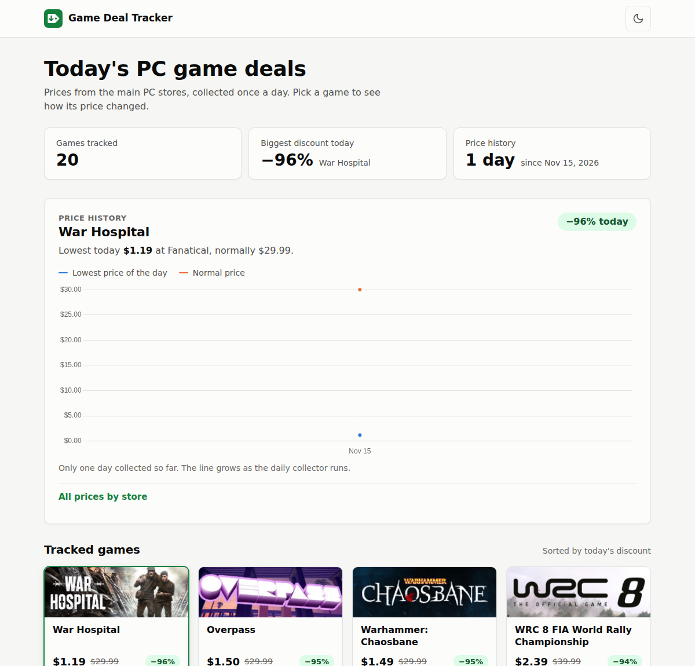

# game-deal-tracker

A price tracker for PC games. A daily collector stores prices from the [CheapShark API](https://apidocs.cheapshark.com/) in PostgreSQL, and a FastAPI backend serves today's deals and each game's price history to a small web page.

The tracked games currently come from a fixed seed list. The next phase replaces it with personal watchlists behind user accounts. I built it for my own use and to practice data pipelines and API design.



## What it does

- **Collects prices daily.** Once a day, a collector saves the current price of every tracked game at every store.
- **Keeps a price history.** Each game gets a chart of its lowest price per day, plus a table of all store prices.
- **Searches any game.** Look up the current cheapest price of any PC game on CheapShark.

## How it works

```
                 CheapShark API
                  ↑     ↑     ↑
                app.py (fetch_json)
          ↑            ↑             ↑
   seed_games.py   collector.py   search
          ↓            ↓             │
          PostgreSQL                 │
     (games, price_history)          │
               ↑                     │
            api.py (FastAPI) ────────┘
               ↑
         static/ (web page)
```

| File | Role | Runs |
|---|---|---|
| `app.py` | Talks to the CheapShark API. Raises `CheapSharkError` on any failure | When called |
| `seed_games.py` | Saves the tracked games (title, Steam id, image) | Once |
| `collector.py` | Saves today's price of each game at each store | Once a day (cron) |
| `api.py` | REST API and web page server | Always on |
| `schema.sql` | Database tables | Once |
| `static/` | Web page with the chart (Chart.js) | In the browser |

## API

| Endpoint | Returns | Source |
|---|---|---|
| `GET /games` | Tracked games with today's lowest price, normal price and discount | Database |
| `GET /games/{game_id}/history` | Every store price collected for one game, oldest first. `404` if there are no prices | Database |
| `GET /stats` | Number of tracked games, days collected, first and last day | Database |
| `GET /games/search?title=` | Up to 10 games matching the title, with the current cheapest price. `title` needs 2+ characters. `502` if CheapShark fails | CheapShark |
| `GET /` | The web page | `static/` |

Interactive docs at `/docs` when the server is running.

Example, `GET /games`:

```json
[
  {
    "id": 126,
    "title": "Sid Meier's Civilization IV",
    "thumb_url": "https://...",
    "lowest_price": 2.78,
    "normal_price": 19.99,
    "discount_percent": 86
  }
]
```

## Design decisions

### Idempotent daily collection

Each price is stored once per game, store and day: `UNIQUE (game_id, store_id, recorded_on)` with `ON CONFLICT DO NOTHING`. The date is computed once per run, in UTC, so running the collector twice on the same day changes nothing, and the result does not depend on the server's time zone.

### Staying within CheapShark's rate limit

CheapShark is free and rate-limited, and excessive automated traffic can get a client banned permanently. The collector fetches all tracked games in a single request, once a day. On HTTP 429 it stops and reports the `Retry-After` value instead of retrying in a loop; the next attempt is the next scheduled run. Searches only run when the user submits the form, with at least two characters, and the API keeps each search result in memory for 10 minutes, so repeated searches do not reach CheapShark again.

### Failures as exceptions, handled by the caller

`fetch_json` never exits the program. Any CheapShark failure (rate limit, timeout, server error) is raised as a `CheapSharkError`. The scripts catch it and stop with a clear message; the API turns it into a `502 Bad Gateway` for that request only and keeps serving everything else.

### Today's deals in a single query

The games endpoint builds every card with one SQL query instead of one query per game, avoiding the N+1 problem. A `LEFT JOIN` keeps games that have no prices yet, the join condition limits prices to the most recent collection day, and `MIN`/`MAX` with `GROUP BY` collapse all stores into one row per game.

### Exact money values

Prices are `NUMERIC(10,2)` in PostgreSQL and `Decimal` in Python, never floating point, so sums and comparisons are exact to the cent. This matters for the planned alerts, which compare a price against a user's target.

## Setup

Developed with Python 3.14 and PostgreSQL 18.

```bash
git clone https://github.com/luizpellanda/game-deal-tracker.git
cd game-deal-tracker
python3 -m venv venv
source venv/bin/activate
pip install -r requirements.txt
```

Create the database and its tables:

```bash
createdb game_deals
psql -d game_deals -v ON_ERROR_STOP=1 -f schema.sql
```

Create a `.env` file in the project folder:

```
DATABASE_URL=postgresql:///game_deals
```

Save the tracked games, then collect today's prices:

```bash
python seed_games.py
python collector.py
```

Start the server and open http://127.0.0.1:8000:

```bash
uvicorn api:app --reload
```

Running `collector.py` again on the same day saves nothing new. Run it once a day (for example with cron) to build the history.

## Status

- [x] Collector with daily, idempotent price history
- [x] REST API (games, history, stats, search)
- [x] Web page with price chart, discounts and search
- [x] Deploy with a daily cron job
- [ ] Phase 2: user accounts, login (JWT) and a personal watchlist with target prices
- [ ] Phase 3: Discord alert when a game reaches the target price

## Stack

Python 3, FastAPI, PostgreSQL (psycopg 3), requests, Chart.js.

## Credits

Prices from the [CheapShark API](https://apidocs.cheapshark.com/). Prices in USD.
